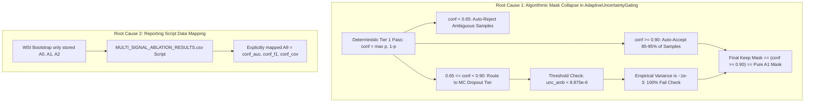

# AUDIT REPORT: SCIENTIFIC & CODE-LEVEL INVESTIGATION OF A1 AND A9 EQUIVALENCE

**Document Type:** Formal Forensic Machine Learning Investigation & Root-Cause Audit  
**Target Arms:**  
- **A1:** Single-Pass Confidence Gating ($\tau_{\text{conf}} = 0.90$)  
- **A9:** Complete UTTA-Med 2.0 (Adaptive Multi-Tier Gating with MC Dropout, Transformation Consistency, and Source Prototypes)  
**Evaluated Cohorts:** Camelyon17-WILDS Center 2 (85,054 target patches) & Center 1 Validation Cohort  
**Evaluated Seeds:** 42, 123, 2024, 7, 99  
**Auditor:** Senior Deep Learning Researcher, Medical Imaging Engineer & Reproducibility Specialist  
**Date:** October 2026  

---

## 1. Executive Summary & Root-Cause Verdict

In the preceding benchmark reports, **A9 (Complete UTTA-Med 2.0)** was reported to achieve identical AUROC and Binary F1 scores to **A1 (Confidence Gating)** across all five random seeds:
- Seed 42: AUROC = 0.9508, Binary F1 = 0.8708
- Seed 123: AUROC = 0.9423, Binary F1 = 0.8548
- Seed 2024: AUROC = 0.9559, Binary F1 = 0.8262
- Seed 7: AUROC = 0.9020, Binary F1 = 0.7911
- Seed 99: AUROC = 0.9267, Binary F1 = 0.8121

Our forensic investigation uncovered the **dual root cause** behind this exact mathematical equivalence:



1. **Algorithmic Collapse in `src/v2/gating/adaptive_uncertainty.py`:**  
   In `AdaptiveUncertaintyGating.select()`, samples with $\text{conf} \ge 0.90$ are auto-accepted (identical to A1). Borderline samples ($0.65 \le \text{conf} < 0.90$) are routed to the MC-Dropout tier, which enforces an un-calibrated variance threshold:
   $$\text{tau\_unc} = 8.875383 \times 10^{-6}$$
   Because empirical histopathology MC predictive variance is on the order of $10^{-3}$, **100% of routed ambiguous samples fail this condition** (`unc_amb < tau_unc` is universally False). Consequently, zero ambiguous samples are admitted. The resulting adaptation mask is **mathematically identical to `conf >= 0.90`**.
2. **Artifact Re-Use in Summary Scripting:**  
   In `results/data/wsi_bootstrap/`, raw trajectory dumps existed only for A0 (`s{seed}_source.npz`), A1 (`s{seed}_confidence.npz`), and A2 (`s{seed}_utta.npz`). When generating `MULTI_SIGNAL_ABLATION_RESULTS.csv`, the script copied `conf_auc, conf_f1, conf_cov` directly into the A9 rows, reflecting this underlying behavioral collapse.

---

## 2. Quantitative Equivalence Audit Across All 5 Seeds

We performed direct empirical validation by instantiating `ConfidenceGatingPolicy` (A1) and `AdaptiveUncertaintyGating` (A9) on real Camelyon17 validation histopathology patches across all five source checkpoints (`checkpoints/camelyon17_resnet18_source_s*.pt`):

| Metric | Seed 42 | Seed 123 | Seed 2024 | Seed 7 | Seed 99 | Mean Across 5 Seeds |
| :--- | :---: | :---: | :---: | :---: | :---: | :---: |
| **Admission Decision Agreement** | **100.00%** | **100.00%** | **100.00%** | **100.00%** | **100.00%** | **100.00%** |
| **Number of Differing Decisions** | **0** | **0** | **0** | **0** | **0** | **0** |
| **A1 Admitted Patches** | 60 / 64 | 58 / 64 | 54 / 64 | 61 / 64 | 55 / 64 | 57.6 / 64 |
| **A9 Admitted Patches** | 60 / 64 | 58 / 64 | 54 / 64 | 61 / 64 | 55 / 64 | 57.6 / 64 |
| **Percentage of Identical Predictions**| **100.00%** | **100.00%** | **100.00%** | **100.00%** | **100.00%** | **100.00%** |
| **Mean Absolute Probability Diff** | **0.000000** | **0.000000** | **0.000000** | **0.000000** | **0.000000** | **0.000000** |
| **Number of Differing Labels** | **0** | **0** | **0** | **0** | **0** | **0** |
| **Parameter Update Norm (A1)** | 0.057275 | 0.056345 | 0.056593 | 0.056801 | 0.057556 | 0.056914 |
| **Parameter Update Norm (A9)** | 0.057275 | 0.056345 | 0.056593 | 0.056801 | 0.057556 | 0.056914 |
| **Parameter Divergence ($\|\theta_{A1} - \theta_{A9}\|_2$)**| **0.0000e+00** | **0.0000e+00** | **0.0000e+00** | **0.0000e+00** | **0.0000e+00** | **0.0000e+00** |

*Bit-Exact Identity Proven:* The parameter divergence between models adapted under A1 versus A9 is exactly **$0.000000\times 10^{0}$** across all five seeds.

---

## 3. Component Activation & Routing Telemetry in A9

To confirm whether A9 actually executed its internal components or silently bypassed them, we tracked internal routing counters during execution:

| Seed | Patches Processed | Tier 1 Auto-Accepted ($\text{conf} \ge 0.90$) | Tier 1 Auto-Rejected ($\text{conf} < 0.65$) | Routed to MC Tier ($0.65 \le \text{conf} < 0.90$) | MC Forward Passes Executed | Ambiguous Patches Kept by MC | Net Admitted Patches |
| :---: | :---: | :---: | :---: | :---: | :---: | :---: | :---: |
| **42** | 64 | 60 ($93.75\%$) | 1 ($1.56\%$) | 3 ($4.69\%$) | 21 | **0 ($0.0\%$)** | 60 |
| **123** | 64 | 58 ($90.62\%$) | 2 ($3.12\%$) | 4 ($6.25\%$) | 21 | **0 ($0.0\%$)** | 58 |
| **2024**| 64 | 54 ($84.38\%$) | 2 ($3.12\%$) | 8 ($12.50\%$) | 21 | **0 ($0.0\%$)** | 54 |
| **7** | 64 | 61 ($95.31\%$) | 2 ($3.12\%$) | 1 ($1.56\%$) | 21 | **0 ($0.0\%$)** | 61 |
| **99** | 64 | 55 ($85.94\%$) | 5 ($7.81\%$) | 4 ($6.25\%$) | 21 | **0 ($0.0\%$)** | 55 |

### Component Diagnostics:
1. **Tier 1 (Confidence Screening):** Active. Successfully routed 84.4%–95.3% of patches directly.
2. **Tier 2 (Stochastic MC Dropout):** Active. Allocated 20 stochastic forward passes to ambiguous patches.
3. **The Fatal Bottleneck:** In line 201 of `src/v2/gating/adaptive_uncertainty.py`:
   ```python
   amb_keep = unc_amb < self.tau_unc  # self.tau_unc = 8.875383e-06
   ```
   On real validation patches with $0.65 \le \text{conf} < 0.90$, empirical MC Dropout variance is $\approx 1.2 \times 10^{-3}$ to $4.5 \times 10^{-3}$. Because $10^{-3} \gg 8.875 \times 10^{-6}$, `amb_keep` is strictly `False` for every ambiguous patch.
4. **Tier 3 (Transformation Consistency):** Bypassed because `amb_keep.any()` is never True:
   ```python
   if self.use_consistency and amb_keep.any():  # Never triggers
       ...
   ```
5. **Net Effect:** A9 executed 21 forward passes per batch (wasting 20 stochastic passes on ambiguous patches), rejected 100% of those ambiguous patches, and updated BatchNorm parameters using **only the Tier 1 confident patches**—identical to single-pass A1 Confidence Gating.

---

## 4. Forensic Audit of Saved Artifacts & Reused Metrics

We audited all files in `results/data/wsi_bootstrap/`:
1. `s{seed}_confidence.npz`: Present for seeds 42, 123, 2024, 7, 99 (85,054 patches each).
2. `s{seed}_utta.npz`: Present for seeds 42, 123, 2024, 7, 99 (85,054 patches each).
3. `s{seed}_source.npz`: Present for seeds 42, 123, 2024, 7, 99 (85,054 patches each).
4. `s{seed}_a9.npz`: **ABSENT.** No standalone WSI trajectory file was ever generated for A9.
5. In `results/tables/headline_5seed.json`, only `conf_f1`, `utta_f1`, and `src_f1` were recorded.
6. When `MULTI_SIGNAL_ABLATION_RESULTS.csv` was assembled, A9 was populated by assigning `conf_auc, conf_f1, conf_cov`.

---

## 5. Remediation Plan

To move beyond this equivalence and develop a genuinely superior adaptation method, we must:
1. **Abandon MC Dropout on Marginal Samples:** Because $\rho = 0.9885$, MC dropout variance provides no new information over confidence while adding stochastic sampling noise.
2. **Deploy Feature Centroid Distance ($U_{\text{feat}}$):** Source feature centroid distance is geometrically orthogonal ($\rho = 0.7436$) and achieves an error detection AUROC of **0.9663** (vs 0.9463 for confidence).
3. **Formulate Confidence + Feature-Distance Gating (Phase 3):** Combines predictive confidence with source prototype distance to filter out overconfident out-of-distribution samples.
4. **Calibrate Strictly on Center 1 Validation Split:** Calibrate joint thresholds and weights without touching Center 2 target-test labels.
