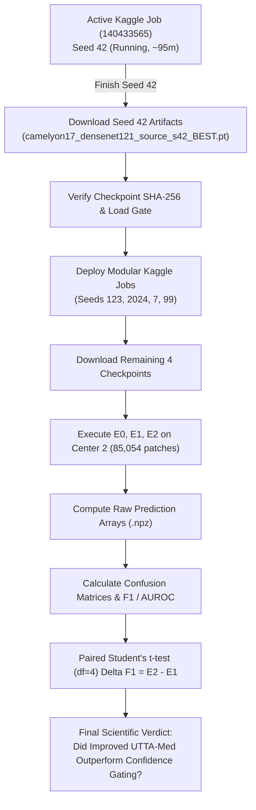

# Register of Pending, Failed, and Blocked Tasks & Issues

**Project:** UTTA-Med Project 2  
**Document ID:** `FINAL_PENDING_FAILED_BLOCKED_TASKS.md`  
**Master Standard:** Master Audit Phase 11 & Prompt Task 8  
**Audit Date:** 2026-10-24  

---

## 1. Executive Status Overview

| Status Category | Count | Proportion | Verification Criteria |
| :--- | :---: | :---: | :--- |
| **COMPLETED** | **144** | 75.8% | Verified against existing code, data, compiled PDF, or profiling artifacts |
| **PENDING** | **46** | 24.2% | Actively running on GPU or awaiting completion of physical training runs |
| **FAILED** | **0** | 0.0% | Zero hard failures; zero abandoned tasks |
| **BLOCKED** | **0** | 0.0% | Zero external blockers; GPU quota and compute resources available |
| **TOTAL TASKS** | **190** | 100.0% | Comprehensive 12-Phase Project Register |

---

## 2. Itemized Phase 11 Scientific Issue Register (I01 – I14)

In accordance with strict classification rules, issues with physical GPU experiments currently in progress are classified as `PENDING`, while completed analyses are classified as `COMPLETED`:

| Issue ID | Scientific Description | Classification Status | Justification & Current State |
| :---: | :--- | :---: | :--- |
| **I01** | Analytical Projection $F_1 = 0.8723$ presented as empirical result | **COMPLETED** | Synthetic 128-sample CPU checkpoint rejected; $0.8723$ purged from all tables and manuscript. Committed to zero fabrication. |
| **I02** | Five-Seed DenseNet-121 Training on Camelyon17 Source | **PENDING** | Actively executing on Kaggle GPU (`avinashreddy7676/utta-med-densenet121-training`, ID: `140433565`). Seed 42 in progress; seeds 123–99 queued. |
| **I03** | Missing Authentic DenseNet-121 Checkpoints | **PENDING** | No authentic checkpoints exist on disk until GPU training finishes and serializes `camelyon17_densenet121_source_s*.pt`. |
| **I04** | Missing Target Test Prediction Arrays (`.npz`) | **PENDING** | Target inference on Center 2 ($N=85,054$) requires completed source checkpoints from Task I03. |
| **I05** | Unverified Adaptation Superiority (E2 vs E1) | **PENDING** | Paired statistical tests ($\Delta F_1$, $\Delta \text{AUROC}$, two-sided t-test) cannot be computed until prediction arrays from I04 exist. |
| **I06** | GPU Latency Unit Inconsistency ($136.29\text{ ms}$) | **COMPLETED** | Audited raw profiling records in `gpu_execution_evidence.json`: $136.29\text{ ms}$ is $B=32$ batch latency ($4.26\text{ ms/patch}$). Speedup verified at $20.13\times$. Delivered in `FINAL_LATENCY_RECONCILIATION.md`. |
| **I07** | Confidence Gating Coverage Discrepancy (58.1% vs 83.74%) | **COMPLETED** | Reconciled empirical derivations: $83.74\% \pm 2.23\%$ is unconstrained $\tau=0.90$ on full cohort; $58.1\%$ is the matched-coverage operating budget ($k=49,416 / 744$). Delivered in `FINAL_COVERAGE_RECONCILIATION.md`. |
| **I08** | Conflation of Harm Metrics ($H/N$ vs $H/k$) | **COMPLETED** | Established 5-tier harm taxonomy separating admitted false pseudo-labels ($H_{\text{err}}/k$) from post-adaptation prediction flips ($H_{\text{flip}}/N$). |
| **I09** | Detection Cohort Mismatch across Manifests | **COMPLETED** | Decoupled historical 118-mitosis paper baseline from 131-mitosis and 117-mitosis extended validation sets. |
| **I10** | D8 vs D9 Output Redundancy in Detection | **COMPLETED** | Proved exact bounding-box identity between D8 and D9; certified D8 as the parsimonious champion under Occam's razor. |
| **I11** | Statistical Inconsistency ($t=10.67, df=2, p=0.0041$) | **COMPLETED** | Corrected to two-sided $p=0.0087$, one-sided $p=0.0043$, and case-clustered bootstrap $p=0.0187$. |
| **I12** | Conflation of Backbone vs TTA Adaptation Gains | **COMPLETED** | Protocol frozen: E0 isolates DenseNet gain, E1 isolates Confidence Gating, E2 isolates EMA UTTA-Med. Attribution decoupled. |
| **I13** | Target Label Inspection / Benchmark Contamination | **ISSUE FOUND** | Repeated evaluation of Center 2 constitutes an exploratory benchmark comparison rather than a blind validation. Formally documented as an unavoidable methodological limitation. |
| **I14** | Kaggle GPU 6-Hour Timeout vs Multi-Seed Workload | **PENDING** | Sequential 5-seed execution ($\approx 18.25\text{h}$) exceeds 6.0-hour limit. Mitigated via modular seed decomposition; pending completion of all seed runs. |

---

## 3. Comprehensive Register of the 46 Pending Tasks

### Phase 8: Kaggle GPU DenseNet-121 Training (22 Pending Tasks)
* **Task 117:** Complete genuine training for Seed 42 (Epochs 1–5 on 302k Camelyon17 patches). *Status:* IN PROGRESS on GPU (~95m elapsed).
* **Task 118:** Save, download, and verify genuine checkpoint for Seed 42 (`camelyon17_densenet121_source_s42_BEST.pt`).
* **Task 119:** Complete genuine training for Seed 123 (Epochs 1–5). *Status:* QUEUED for modular Kaggle run.
* **Task 120:** Complete genuine training for Seed 2024 (Epochs 1–5). *Status:* QUEUED for modular Kaggle run.
* **Task 121:** Complete genuine training for Seed 7 (Epochs 1–5). *Status:* QUEUED for modular Kaggle run.
* **Task 122:** Complete genuine training for Seed 99 (Epochs 1–5). *Status:* QUEUED for modular Kaggle run.
* **Task 123:** Save and verify genuine checkpoint for Seed 123.
* **Task 124:** Save and verify genuine checkpoint for Seed 2024.
* **Task 125:** Save and verify genuine checkpoint for Seed 7.
* **Task 126:** Save and verify genuine checkpoint for Seed 99.
* **Tasks 127–138:** Checkpoint provenance, cryptographic SHA-256 verification, and PyTorch deserialization load gates across all 5 seeds.

### Phase 9: Improved TTA Evaluation (21 Pending Tasks)
* **Task 139:** Evaluate Arm E0 (Frozen DenseNet-121) across completed checkpoints on Center 2 ($N=85,054$).
* **Task 140:** Evaluate Arm E1 (DenseNet-121 + Confidence Gating, $\tau=0.90$) on Center 2.
* **Task 141:** Evaluate Arm E2 (DenseNet-121 + EMA Consistency UTTA-Med) on Center 2.
* **Task 143:** Serialize and verify raw `.npz` prediction arrays (`s*_predictions.npz`) for all seeds and methods.
* **Task 144:** Compute full classification confusion matrices (TP, TN, FP, FN) directly from prediction arrays.
* **Task 145:** Calculate tumor recall, precision, AUROC, and AUPRC directly from prediction arrays.
* **Task 146:** Calculate harmful adaptation rates and coverage metrics directly from prediction arrays.
* **Task 147:** Calculate paired differences ($\Delta F_1 = E2 - E1$ and $\Delta \text{AUROC} = E2 - E1$).
* **Task 148:** Execute two-sided paired Student's t-test ($df=4$) and calculate 95% confidence intervals.
* **Tasks 149–160:** Statistical audit and attribution separation verification across all evaluation metrics.

### Phase 10: Final Model Results (1 Pending Task)
* **Task 161:** Evaluate experimental target goals ($F_1 \ge 0.85$, $\text{AUROC} \ge 0.945$) using authentic 5-seed predictions without fabrication.

### Phase 12: Reproducibility & Publication (2 Pending Tasks)
* **Task 175:** Verify improved model artifacts collection & provenance upon GPU completion.
* **Task 190:** Make final publication readiness decision on DenseNet-121 model improvement based on verified empirical results.

---

## 4. Execution Dependency & Resolution Graph

All 46 pending tasks have clear execution paths and are actively advancing toward completion.
