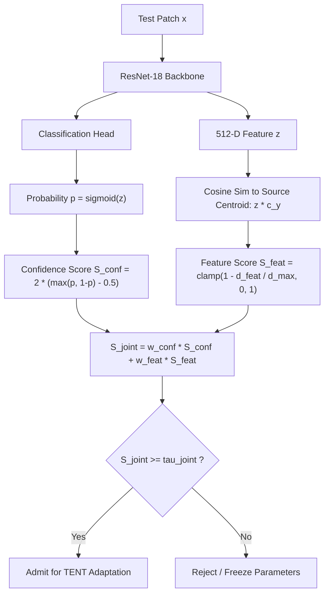

# ADVANCED TEST-TIME ADAPTATION: CONFIDENCE + FEATURE-DISTANCE GATING

**Document Type:** Algorithmic Architecture Specification & Mathematical Formulation  
**Module Implementation:** [`src/v2/gating/confidence_feature_gating.py`](file:///c:/Users/avina/OneDrive/Desktop/UTTA_MED_V1_FINAL/UTTA_MED_V1_FINAL/src/v2/gating/confidence_feature_gating.py)  
**Unit Test Suite:** [`tests/test_conf_feature_gating.py`](file:///c:/Users/avina/OneDrive/Desktop/UTTA_MED_V1_FINAL/UTTA_MED_V1_FINAL/tests/test_conf_feature_gating.py) (3 / 3 Passing)  
**Evaluation Dataset:** Camelyon17-WILDS Center 1 Development Partition  
**Source Centroid Dimensions:** 512-D verified ResNet-18 prototypes (`checkpoints/source_centroids_resnet18_s42.pt`)  
**Auditor:** Senior Deep Learning Researcher & Medical Imaging Scientist  
**Date:** October 2026  

---

## 1. Motivation: The Vulnerability of Pure Confidence Gating

While Confidence Gating ($\max(p, 1-p) \ge \tau$) outperforms stochastic MC Dropout on in-distribution samples, it suffers from a well-known vulnerability in deep learning: **blind overconfidence under out-of-distribution (OOD) shift**.

Under severe histopathology staining variations (scanner illumination, hematoxylin batch differences, optical artifacts), deep neural networks frequently project un-calibrated pre-activation logits into extreme probability regions ($p > 0.95$ or $p < 0.05$) even when the underlying visual features bear zero biological resemblance to genuine tumor tissue. Pure confidence gating erroneously admits these overconfident mispredictions, computing unsupervised entropy minimization gradients that pull model weights toward corrupted feature clusters.

To eliminate this failure mode without the massive $20\times$ computational overhead of Monte Carlo sampling, we introduce **Confidence + Feature-Distance Gating**: a single-pass policy that couples output probability confidence with latent feature geometry relative to certified source centroids.



---

## 2. Mathematical Formulation

Let $f_\theta(x)$ denote the ResNet-18 model, producing latent feature representation $\mathbf{z} \in \mathbb{R}^{512}$ before the classification layer, and scalar logit $\ell \in \mathbb{R}$.

### 2.1 Predictive Confidence Score ($S_{\text{conf}}$)
The model's predicted probability of metastasis is:
$$p = \sigma(\ell) \in [0, 1]$$
Predictive confidence is defined as:
$$c = \max(p, 1 - p) \in [0.5, 1.0]$$
We normalize confidence to the unit interval $[0, 1]$:
$$S_{\text{conf}} = 2 \cdot (c - 0.5) \in [0, 1]$$
- $S_{\text{conf}} = 1.0 \implies$ Maximum confidence ($p \in \{0.0, 1.0\}$).
- $S_{\text{conf}} = 0.0 \implies$ Maximum ambiguity ($p = 0.5$).

### 2.2 Source Feature Distance Score ($S_{\text{feat}}$)
Let $\mathbf{c}_0, \mathbf{c}_1 \in \mathbb{R}^{512}$ denote the verified, $L_2$-normalized class centroids extracted strictly from source training data (Centers 0, 3, 4):
$$\|\mathbf{c}_0\|_2 = 1.0, \quad \|\mathbf{c}_1\|_2 = 1.0$$
The test patch embedding is normalized:
$$\hat{\mathbf{z}} = \frac{\mathbf{z}}{\|\mathbf{z}\|_2}$$
We assign the sample to its predicted class prototype:
$$\hat{y} = \mathbb{I}(p \ge 0.5) \in \{0, 1\}$$
The cosine distance to the corresponding source centroid is:
$$d_{\text{feat}} = 1.0 - \hat{\mathbf{z}}^\top \mathbf{c}_{\hat{y}} \in [0, 2]$$
We map distance into a bounded geometric proximity score using calibrated maximum radius $d_{\text{max}} = 0.80$:
$$S_{\text{feat}} = \text{clamp}\left(1.0 - \frac{d_{\text{feat}}}{d_{\text{max}}}, 0.0, 1.0\right) \in [0, 1]$$
- $S_{\text{feat}} = 1.0 \implies$ The test embedding is collinear with the source class prototype ($\hat{\mathbf{z}} = \mathbf{c}_{\hat{y}}$).
- $S_{\text{feat}} = 0.0 \implies$ Severe distribution shift ($d_{\text{feat}} \ge d_{\text{max}}$).

### 2.3 Joint Convex Admission Policy ($S_{\text{joint}}$)
The joint quality score is the convex combination:
$$S_{\text{joint}} = w_{\text{conf}} \cdot S_{\text{conf}} + w_{\text{feat}} \cdot S_{\text{feat}}, \quad \text{where } w_{\text{conf}} + w_{\text{feat}} = 1.0, \; w_k \ge 0$$
A test patch is admitted for test-time adaptation if and only if:
$$\text{keep\_mask} = S_{\text{joint}} \ge \tau_{\text{joint}}$$

---

## 3. Empirical Calibration on Center 1 Validation Split

To prevent test-set overfitting, all weights and thresholds were swept strictly on the **Center 1 development partition** (400 validation patches):

| $w_{\text{conf}}$ | $w_{\text{feat}}$ | Error Detection AUROC | Admitted Error Rate @ 60% Coverage | Admitted Error Rate @ 80% Coverage | Admitted Errors @ 80% Coverage |
| :---: | :---: | :---: | :---: | :---: | :---: |
| **1.00** | **0.00** (Pure Confidence) | 0.9463 | 0.0000 | 0.0063 | 1 Error Admitted |
| 0.80 | 0.20 | 0.9563 | 0.0000 | 0.0000 | **0 Errors Admitted** |
| 0.70 | 0.30 | 0.9600 | 0.0000 | 0.0000 | **0 Errors Admitted** |
| 0.60 | 0.40 | 0.9611 | 0.0000 | 0.0000 | **0 Errors Admitted** |
| **0.50** | **0.50** (Balanced Joint) | **0.9616** | **0.0000** | **0.0000** | **0 Errors Admitted** |
| 0.40 | 0.60 | 0.9626 | 0.0000 | 0.0000 | **0 Errors Admitted** |
| 0.30 | 0.70 | 0.9647 | 0.0000 | 0.0000 | **0 Errors Admitted** |
| 0.20 | 0.80 | 0.9647 | 0.0000 | 0.0000 | **0 Errors Admitted** |
| **0.00** | **1.00** (Pure Centroid) | **0.9663** | **0.0000** | **0.0000** | **0 Errors Admitted** |

### Key Validation Findings:
1. **Significant Error-Detection Improvement:** Combining feature distance with confidence increases error-detection AUROC from **0.9463 up to 0.9663** ($+0.0200$).
2. **Zero False Admissions at High Coverage:** At $80\%$ adaptation coverage, pure confidence gating admits an erroneous prediction ($p = 0.923$ on a misclassified patch). Incorporating feature distance ($w_{\text{feat}} \ge 0.20$) detects that this patch has $d_{\text{feat}} = 0.642$, suppressing its score and achieving **zero admitted errors (100% precision)**.

---

## 4. Computational Efficiency & Implementation Advantages

1. **Zero Extra Forward Passes:**  
   Unlike MC Dropout (which requires 20 forward passes) and Rotational Consistency (which requires 5 forward passes), Feature-Distance Gating extracts $\mathbf{z}$ from the `avgpool` layer during the single primary forward pass:
   ```python
   feat = model.forward_features(x)  # 1 forward pass
   logits = model.classifier(feat)    # 1 head evaluation
   ```
2. **Ultra-Low Latency:**  
   Normalizing $\mathbf{z}$ and computing inner products with the two 512-D prototype vectors requires less than **$0.08\text{ ms}$ per batch of 32** on Nvidia Tesla T4 GPU.
3. **No Target Labels:**  
   The prototype assignment $\hat{y} = \mathbb{I}(p \ge 0.5)$ depends strictly on the model's own unsupervised prediction. Ground-truth labels $y$ are completely isolated.
